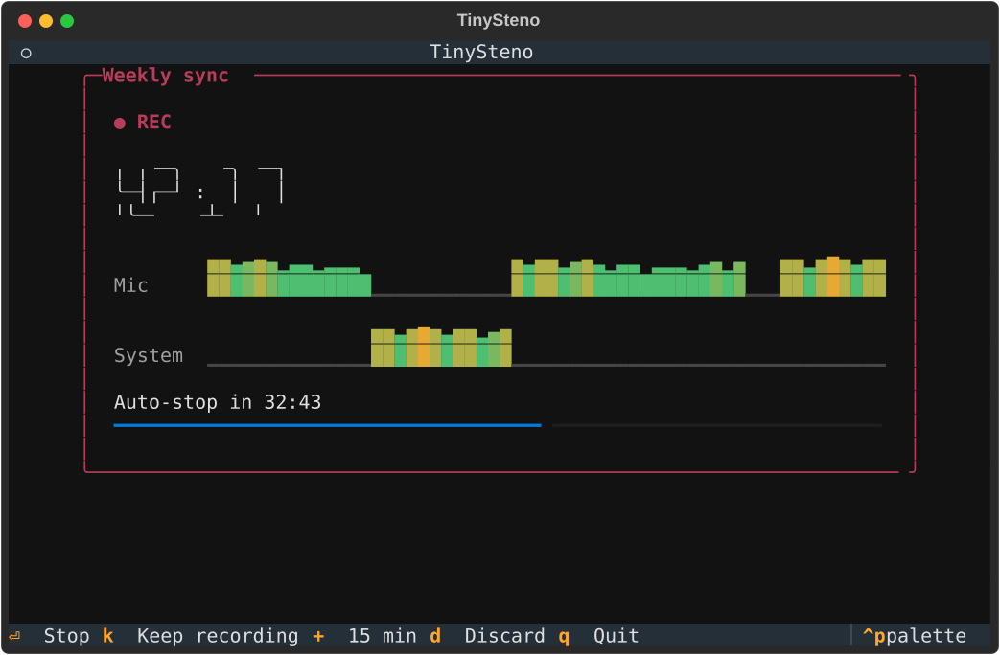
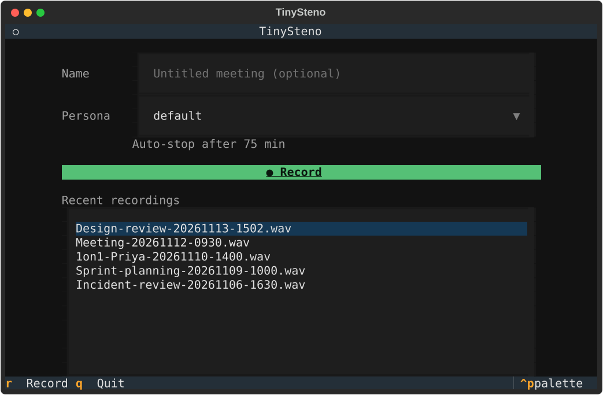
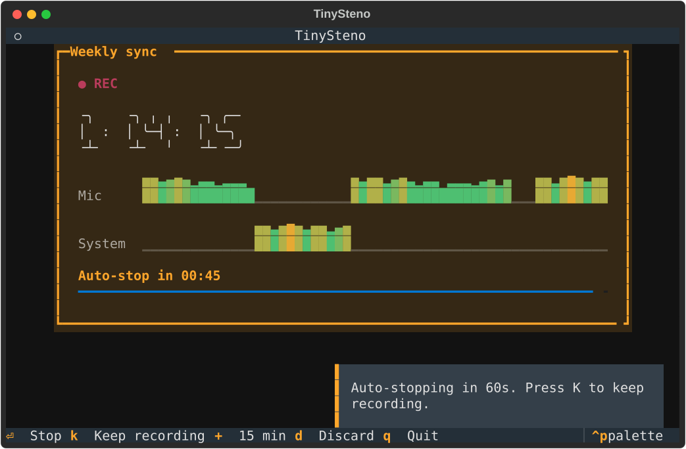
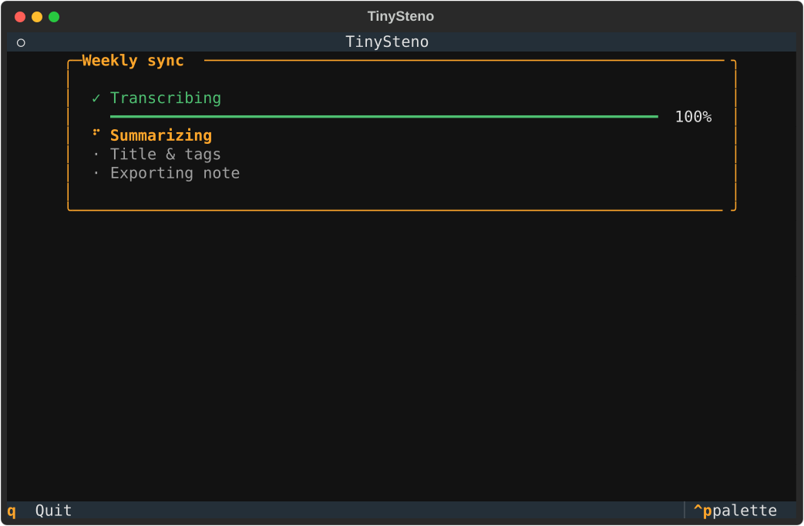
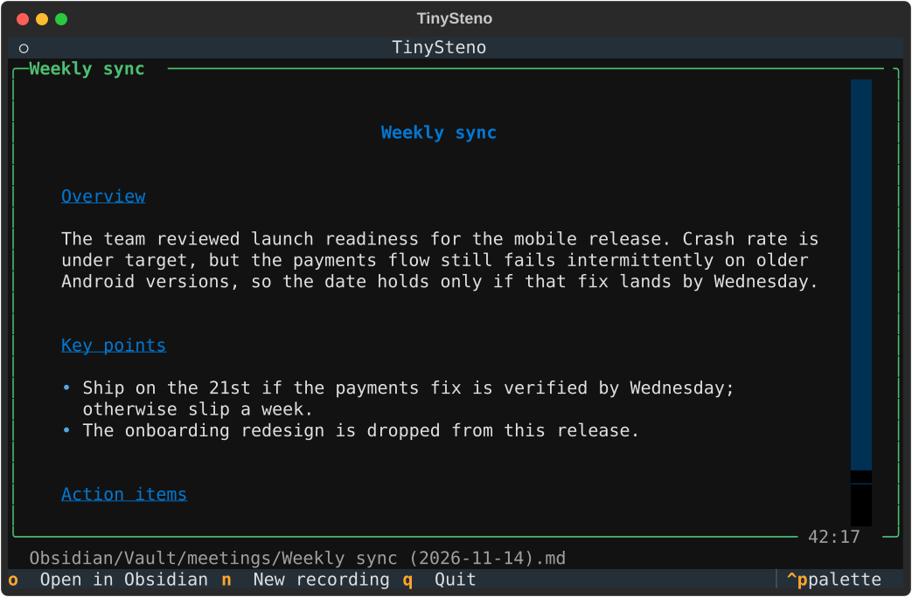

# TinySteno

Inspired by [StenoAI](https://github.com/ruzin/stenoai).
Minimal meeting recorder with Obsidian export (local filesystem vault).



## Features

- Record meetings (Ctrl+C to stop; auto-stops after 75 minutes by default, change it with `--timeout` or `session_timeout_minutes`, `0` disables)
- Interactive terminal UI (`tinysteno`) with live level meters, per-stage progress and an in-terminal note preview
- Captures mic + system audio simultaneously — no virtual audio device required
- Transcribe with faster-whisper (local CPU/GPU) or OpenAI Whisper API
- GPU auto-detection — CUDA, with a CPU fallback (Apple Silicon runs on the CPU)
- Stereo diarization — `[You]` / `[Others]` labels when system audio is captured
- Optional, best-effort speaker split of the remote side (`Speaker 2`, `Speaker 3`, ...), off by default; see "Speaker split (optional)"
- Summarize via OpenAI-compatible API (Ollama, OpenAI, OpenRouter, etc.)
- Handles long transcripts automatically — splits into chunks sized to the model's context window, summarizes each, then merges
- Timestamped transcript lines, and clean-up of lines Whisper invents in silence and of speaker audio picked up by the microphone
- The model is told the meeting date, who `[You]` and `[Others]` are, and any notes you pass with `--notes`
- Keeps the transcript beside the recording, so a retry skips transcription
- Persona system — choose how recordings are summarized and formatted
- Auto-generate note titles and tags from content
- Export structured markdown notes to Obsidian vault

## Prerequisites
- [Python 3.12+](https://www.python.org/downloads/)
- [UV](https://docs.astral.sh/uv/getting-started/installation/)
- An [OpenAI](https://platform.openai.com/) Compatible API
  - [Ollama](https://ollama.com)
  - [LMStudio](https://lmstudio.ai)
  - [OpenRouter](https://openrouter.ai)
  - MORE!

## Installation

**UV:**
```bash
uv tool install git+https://github.com/onyxhat/TinySteno
```

**Manually:**
```bash
git clone https://github.com/onyxhat/TinySteno.git
cd TinySteno
uv sync
uv run tinysteno --help
```

## Usage

```bash
# Update config interactively (also seeds built-in personas to ~/.tinysteno/personas/)
tinysteno setup

# Reset built-in personas to defaults (overwrites any edits you've made to them)
tinysteno setup --reset-personas

# Open the terminal UI (when run in a terminal with no subcommand)
tinysteno

# Open the terminal UI and start recording immediately
tinysteno tui --now

# Record a meeting (uses default persona)
tinysteno record

# Record with custom name
tinysteno record --name "Budget Review"

# Record with a 30 minute limit (0 = no limit)
tinysteno record --timeout 30

# Record using a specific persona
tinysteno record --persona rca

# Record with Whisper API backend
tinysteno record --backend api --whisper-api-key sk-...

# Record with explicit GPU device override
tinysteno record --whisper-device cuda --whisper-compute-type float16

# Process existing audio file
tinysteno process recordings/Meeting.wav

# Process with API backend and specific model
tinysteno process recordings/Meeting.wav --backend api --whisper-api-model whisper-large-v3

# Process with a specific persona
tinysteno process recordings/Meeting.wav --persona executive-summary

# Give the summary your own notes about the meeting (also on `record` and `tui`)
tinysteno process recordings/Meeting.wav --notes agenda.txt

# Transcribe again instead of reusing the saved transcript
tinysteno process recordings/Meeting.wav --retranscribe

# Expect at most 3 voices on the remote side (also on `record` and `tui`; needs speaker_split)
tinysteno process recordings/Meeting.wav --speakers 3

# Verify setup
tinysteno test

# List processed meetings
tinysteno list --vault /path/to/vault

# Show current config
tinysteno config

# Edit config in $EDITOR
tinysteno config --edit
```

## TUI

Run `tinysteno` with no subcommand in a terminal to open the interactive interface (outside a terminal it prints help, as before). `tinysteno tui` does the same and accepts `--now`, `--name`, `--persona`, `--timeout MINUTES`, `--notes PATH` and the transcription override flags.

```bash
tinysteno                       # open the TUI on the Home screen
tinysteno tui --now             # skip Home and start recording immediately
tinysteno tui --persona rca --name "Postmortem" --timeout 90
```

The happy path is `tinysteno`, `Enter` to record, `Enter` to stop, and the finished note appears on screen. The screens are Home (name, persona, recent recordings), Recording (elapsed clock, one rolling level meter for Mic and one for System, auto-stop countdown), Processing (a checklist of transcribe, summarize, title and tags, export) and Result (the exported note rendered in the terminal).

### Screens

**Home.** Record is focused, so `Enter` starts straight away. The name is optional, the persona defaults to your configured one, and the line under it shows the timeout that will apply.



**Recording.** Elapsed time, one rolling meter each for the microphone and system audio, and the auto-stop countdown.


**Last minute before auto-stop.** The panel changes colour and a notice appears; `k` keeps recording, `+` adds 15 minutes.



**Processing.** Each stage is ticked off as it finishes; transcription shows real progress.



**Result.** The exported note, rendered in the terminal, with its path underneath.



The screenshots are generated from the real app with stand-in audio and a sample note: `uv run python scripts/tui_screenshots.py`.

### Keys

| Screen | Key | Action |
|--------|-----|--------|
| Home | `Enter` on Record, or `r` | Start recording with the current name and persona |
| Home | `Enter` in the Name box | Start recording |
| Home | `Enter` on a recent recording | Process that WAV with the selected persona |
| Recording | `Enter`, `Space`, `s` | Stop and process (ignored, with a `Still starting…` notice, until the recorder has started) |
| Recording | `k` | Keep recording: cancel the auto-stop for this session |
| Recording | `+` | Extend the auto-stop by 15 minutes |
| Recording | `d` | Discard: opens a confirmation (`y` discards, `n` or `Esc` keeps recording, `q` quits and saves) |
| Processing | `r` | Retry, after a failed stage (not after "No speech detected") |
| Processing | `n` | Back to Home (once the pipeline is no longer running) |
| Result | `o` | Open the note in Obsidian |
| Result | `n` | Back to Home |
| Home, Recording, Processing, Result | `q` | Quit (see below) |
| Any screen, including the discard confirmation | `Ctrl+Q` | Quit |

`r` and `q` are ordinary text while the Name box has focus. In the discard confirmation `q` quits the same way as everywhere else: the recording is saved, not discarded. The footer only lists keys that do something right now: `r` and `n` appear on the Processing screen once the pipeline has stopped running.

Things to know:

- **Timeout.** The Home screen shows the limit that applies to the selected persona (`Auto-stop after 75 min` or `No time limit`). In the last 60 seconds the Recording panel turns to the warning colour, a toast appears and the terminal bell rings; press `k` to keep recording. When the timer reaches zero the recording stops and is processed normally; nothing is discarded. `+` with no limit set does nothing but say so.
- **Starting takes a moment.** On macOS, starting system-audio capture can take several seconds; the Recording screen says `Starting…` meanwhile. Stop keys pressed then are ignored (a second `Enter` from Home will not end the recording as it begins); `q` still works and saves whatever was recorded.
- **Quitting while recording** stops the recording and saves the WAV, but does not process it. TinySteno exits and prints the saved path and the `tinysteno process` command to run. Closing the terminal window (SIGHUP) or `kill` (SIGTERM) does the same, and if the interface itself crashes the recording is still stopped and saved before TinySteno exits. Headless `tinysteno record` behaves the same way: a closed terminal or `kill` stops and saves the recording and prints the `tinysteno process` command instead of starting to process.
- **A failed save keeps the raw audio.** If the WAV cannot be written (for example a full disk), the raw microphone and system-audio files are kept rather than deleted, and the error names them. In the TUI that notice stays on screen until you press `Esc` or click it, and when you quit TinySteno prints it to stderr and exits with code 1. That holds whenever you quit, even if the save failed earlier and you went back to Home in between.
- **Quitting during processing** exits immediately; the pipeline is not waited for, so it is abandoned and may not finish writing a note. The WAV stays on disk and TinySteno prints the `tinysteno process` command to finish the job. The same message is printed for every recording that has no note yet when you quit: after a failed stage or "No speech detected", whether you are still on the Processing screen or went back to Home first.
- **Failures keep your audio.** A failed stage or "No speech detected" leaves the WAV where it is and says so on the Processing screen. After a failed stage `r` runs the pipeline again from the top; after "No speech detected" there is nothing to retry, so only `n` (Home) is offered.
- **Only `d`, confirmed, deletes audio.**
- **One stream ending early does not shorten the recording.** If system-audio capture stops part-way through (or the microphone delivers nothing), the WAV still runs for the full length, with silence on that channel.
- **Level meters.** Each meter is on a fixed scale from -60 dBFS (empty) to 0 dBFS (full), with the newest sound at the right; green is normal speech, amber is loud, red is close to clipping. An empty meter, just a faint baseline, means that input is at or below -60 dBFS: silent, muted, or the wrong device.
- **System audio.** If system audio is not being captured, the System meter reads `System audio unavailable` and only the microphone is recorded. When macOS capture failed to start (usually missing Screen Recording permission), a warning toast says why.
- **Log file.** While the TUI runs, log messages go to `~/.tinysteno/tui.log` (appended) instead of the terminal, so they cannot paint over the screen; `--verbose` logs at DEBUG level there. When the session logged a warning or exited with an error, TinySteno's last line of output is `Log: ~/.tinysteno/tui.log`. The other commands still log to stderr.
- **Processing a recent recording from Home** uses the file's modification time as the meeting date and no meeting name.
- **Themes.** The command palette (`Ctrl+P`) switches between Textual's built-in themes; set `tui_theme` in `config.yaml` (for example `tokyo-night`, `nord`, `gruvbox`) to choose the one TinySteno starts with.

Relevant config keys:

```yaml
session_timeout_minutes: 75   # auto-stop for `record` and the TUI; 0 disables
tui_theme: "tokyo-night"      # optional starting theme for the TUI
```

## Personas

Personas control what the LLM extracts from a transcript and how the Obsidian note is rendered. Each persona defines a system prompt, an output schema, and a Jinja2 note template.

### Built-in personas

Built-in personas are seeded to `~/.tinysteno/personas/` on first run, so you can inspect and edit them directly. To restore them to their defaults, run `tinysteno setup --reset-personas`.

| Slug | Name | Use for |
|------|------|---------|
| `default` | Meeting Summary | General meetings — overview, participants, key points, action items |
| `1on1` | 1-on-1 Meeting Analyst | Manager/report 1-on-1s — goals, needs, struggles, recent wins, per-side actions |
| `rca` | Root Cause Analysis | Postmortems — timeline, root cause, contributing factors, corrective actions |
| `irm` | Incident Response & Management | Incident calls — severity, impact, responders, mitigations, follow-ups |
| `sprint` | Sprint Ceremony | Planning/review/retros — completed work, blockers, retrospective notes |
| `kickoff` | Project Kickoff | Project kickoffs — objectives, stakeholders, scope, risks, decisions |
| `executive-summary` | Executive Summary | Decision-ready briefing — bottom line, key decisions, risks, asks |

### Custom personas

Drop a directory into `~/.tinysteno/personas/<slug>/` with three files:

```
~/.tinysteno/personas/
└── my-persona/
    ├── persona.yaml      # name, description, schema
    ├── system_prompt.md  # LLM system message
    └── template.md       # Jinja2 Obsidian note template
```

**`persona.yaml`** example:

```yaml
name: My Persona
description: What this persona does.
schema:
  summary:
    type: string
    description: A brief summary
  highlights:
    type: list
    description: Key highlights as strings
```

A persona may also set an optional `session_timeout_minutes` (a number `>= 0`; `0` means no limit) to override the global recording timeout for that persona:

```yaml
session_timeout_minutes: 120   # this persona may record for up to 2 hours
```

The timeout that applies to a recording is, in order: the `--timeout` flag, the persona's `session_timeout_minutes`, the `session_timeout_minutes` value in `config.yaml`, then 75 minutes. `0` disables the limit at any of those levels.

Schema field types are `string` or `list` (list of strings). Field names must be valid Python identifiers and cannot collide with reserved metadata variables: `title`, `date`, `duration`, `transcript`, `detected_language`, `generated_tags`, `tags`, `processing_warnings`.

**`template.md`** receives all schema fields plus the metadata variables above as Jinja2 context.

## Configuration

Config file: `~/.tinysteno/config.yaml`

Run `tinysteno setup` to create it interactively, or create it manually:

```yaml
# Obsidian vault path (~ is expanded)
obsidian_vault: "~/Obsidian/Vault"

# Output settings
output_folder: "meetings"   # subfolder inside vault

# Where to store raw audio recordings
# Defaults to <obsidian_vault>/<output_folder>/audio if not set
# recordings_path: "~/recordings"

# Persona to use when --persona is not specified
persona: "default"

# OpenAI-compatible API settings
# Ollama (local):  base_url: "http://localhost:11434/v1", api_key: "ollama"
# OpenAI (cloud):  base_url: "https://api.openai.com/v1", api_key: "sk-..."
api_key: "ollama"
base_url: "http://localhost:11434/v1"
model: "llama3.2:3b"
# Context window, in tokens, the model is actually served with. Transcripts are
# split into chunks of 60% of it (at 2 characters per token); values below 500
# are treated as 500. Must be a whole number. See "Long transcripts" below.
llm_context_tokens: 8192
auto_title: true            # generate note titles from content
auto_tags: true             # generate tags from content

# Transcription
# Model sizes (speed ↔ accuracy): tiny · base · small · medium · large
whisper_model: "small"

# Backend: "local" (default, faster-whisper) or "api" (OpenAI Whisper API)
transcription_backend: "local"

# Device override for local backend: "auto" (default, auto-detect), "cpu", "cuda"
# Architecture is auto-detected when set to "auto":
#   - CUDA available → cuda + float16
#   - Apple Silicon → auto + auto (CTranslate2 has no MPS support, so this runs on the CPU)
#   - Fallback → cpu + int8
whisper_device: "auto"
whisper_compute_type: "auto"

# Local backend only: skip stretches without speech (faster-whisper's VAD filter)
whisper_vad: true
# Text that primes Whisper's vocabulary: names, product terms, acronyms ("" = none).
# Used by both backends; keep it short.
whisper_prompt: ""

# Transcript clean-up, see "Transcript clean-up" below
hallucination_filter: true  # drop caption credits and repeats Whisper invents in silence
bleed_filter: true          # drop the quieter copy of a sentence heard on both channels

# Speaker split, see "Speaker split (optional)" below
speaker_split: false        # best-effort split of the remote side into Speaker 2, 3, ...;
                            # only does anything when diarization is also true
# max_speakers: 4           # optional cap on the voices kept (a whole number >= 1);
                            # the same as --speakers N

# API endpoint for remote transcription
# Uses the same base_url/api_key as the summarizer if not set
# whisper_base_url: "https://api.openai.com/v1"
# whisper_api_key: "sk-..."
# whisper_api_model: "whisper-1"
whisper_api_timeout: 600    # seconds each transcription request may take (a positive number)
whisper_api_diarize: false  # ask a WhisperX-style server for speaker labels; see below

# Feature flags
diarization: false          # add [You]/[Others] speaker labels; both channels are
                            # transcribed either way. System audio is captured as the
                            # right channel of a stereo file (L=mic, R=system audio)
transcript_timestamps: true # start each transcript line with its [hh:mm:ss] time

# Recording session limit in minutes: recording stops and is processed when it
# elapses. 0 disables. Asked for by `tinysteno setup`. A persona's session_timeout_minutes or --timeout overrides it.
session_timeout_minutes: 75

# Starting theme for the TUI (optional)
# tui_theme: "tokyo-night"

# Audio recording
sample_rate: 44100
channels: 1                 # mic input channels; the file is stereo only when
                            # system audio was captured, otherwise mono
```

## Output Format

Note format is controlled by the active persona's template. The default persona produces:

```markdown
---
created: 2024-01-15 14:30
type: meeting
tags: [meeting, budget, planning]
duration: 00:45:12
participants: Alice, Bob
---

# Budget Review

## Overview
AI-generated summary of the meeting.

## Participants
- Alice
- Bob

## Key Points
1. Point one
2. Point two

## Action Items
- [ ] Follow up with the team (Alice)

## Transcript
\```
[00:00:03] First line of the transcript.
[00:00:09] Second line of the transcript.
\```
```

Each transcript line is one recognised segment, prefixed with its start time from the beginning of the recording as `[hh:mm:ss]`. Set `transcript_timestamps: false` to leave the times out; the lines then run together as plain text, as they did before.

System audio is always transcribed when it is captured. Each channel is transcribed separately and a silent channel is skipped. If a channel has audio but no speech is recognised, or part of a summary could not be generated, the CLI prints `Warning:` lines, the TUI shows them, and the note gets a `## Processing warnings` section listing them. A note never overwrites an earlier one: a second note with the same title and date is saved as `<title> (<date>) 2.md`, then ` 3`, and so on. A recording made before this version with a 2-channel microphone and no system audio is still read as mic and system. When diarization is enabled, the transcript is interleaved chronologically and each line also carries a `[You]` / `[Others]` speaker label after the time:

```
[00:00:03] [You] I think we should go with option A.
[00:00:07] [Others] That makes sense, let's proceed.
[00:00:12] [You] Great, I'll follow up with the team.
```

### Transcript clean-up

Whisper sometimes writes text for silence, and the microphone can pick up the other side of a call from your speakers. Two filters remove such lines while the transcript is built, for both backends. Everything they remove is logged at INFO (run with `--verbose` to see it) with the reason, speaker, start time and text. Both are on by default.

`hallucination_filter` works on each channel separately and removes:

- **Caption credits**: a line that starts with "Subtitles by ...", "Captions provided by ...", "Transcribed by ..." or "Translated by ..." (up to 10 words), a line that is only "Thanks for watching" (optionally with "please subscribe"), a short line (up to 8 words) starting "Please subscribe", and any line containing amara.org. A sentence that merely mentions subtitles somewhere in the middle is kept.
- **Stuck repeats**: when the same line comes five or more times in a row, the first is kept and the rest are removed.
- **Stranded short repeats**: a line of five words or fewer that occurs at least three times on its channel is removed only when it sits alone in silence (no other line within 10 seconds on either side) AND the audio there is much quieter than the rest of the channel (under a quarter of the median level of that channel's lines). It is never removed without that audio evidence, so a run of genuine "Yeah." and "Okay." in a live conversation stays.

What it can get wrong: a quiet, isolated "Thank you." that someone really said, three times, in a meeting with long pauses, can be removed. A real sentence that starts with "Subtitles by" or "Translated by" is removed too. Stuck repeats are removed even when the audio is loud, so five identical lines in a row are always reduced to one.

`bleed_filter` applies to a stereo recording, where the microphone and system audio are transcribed separately. A sentence transcribed on both channels starting within three seconds of each other loses its quieter copy (measured on the audio of each channel, not the label); the microphone copy goes when the levels are equal. It only compares lines of at least 15 characters whose words overlap by half or more, so short agreement such as "Sounds good." said on both sides is kept.

What it can get wrong: two people genuinely saying the same long sentence at the same moment lose one copy. Speech that bleeds in at a level close to the real signal may keep the wrong copy.

Set `hallucination_filter: false` and/or `bleed_filter: false` in `config.yaml` to switch either off. The filters run when a recording is transcribed. A transcript saved earlier (see below) was made with the filter settings of that time, so changing either filter makes TinySteno transcribe the recording again rather than reuse it.

### Speaker split (optional)

By default the transcript has two voices: `You` (the microphone) and `Others` (everything that came through system audio). With `speaker_split: true` TinySteno also tries to tell the people on the remote side apart and labels them `Others`, `Speaker 2`, `Speaker 3` and so on, so a summary can keep what different people said apart. It is off by default and it is a best-effort split: it works from the sound of the voices alone, it never knows names, and it can be wrong.

```
[00:00:03] [You] I think we should go with option A.
[00:00:07] [Others] That makes sense, let's proceed.
[00:00:09] [Speaker 2] I agree, and the budget supports it.
```

**Setup.** The separation uses the optional `diarize` extra, which is not installed by default:

```bash
pip install "tinysteno[diarize]"      # or, from a checkout: uv sync --extra diarize
```

Then set `speaker_split: true` in `config.yaml`. It does something only when `diarization` (the speaker labels) is also `true`. With `speaker_split: true` and `diarization: false` nothing is split, no models are downloaded and no warning is shown, because there are no labels to change.

**First use.** The first time a recording is split, TinySteno downloads two model files from GitHub (sherpa-onnx releases) into `~/.tinysteno/models/diarize/`, about 35 MB in all: the pyannote segmentation model (`sherpa-onnx-pyannote-segmentation-3-0.tar.bz2`, unpacked to `model.onnx`) and the speaker-embedding model (`3dspeaker_speech_campplus_sv_zh_en_16k-common_advanced.onnx`). Downloads are HTTPS only, refuse a file over 100 MB and are checked against pinned SHA-256 checksums before they are used; a download that fails or does not match leaves no partial file (a model already fetched and verified stays). Later runs reuse the files and need no network. If the extra is not installed, the download fails or a checksum does not match, or the diarizer itself fails, the transcript keeps its plain `You` / `Others` labels and the note gets a `## Processing warnings` entry with the reason: the `pip install` line above for the missing extra, "Could not download the speaker-separation models: ..." for a failed download or checksum, or "Speaker separation could not run: ..." for an error while the diarizer runs. Any other error in the split step gives the generic entry "Speaker separation failed; channel labels were used."

**Which voices are split.**

- On a call, only the remote side (the system audio channel) is split. The microphone is never split on a recording that has system audio: it stays `You`.
- The microphone is split only when there is no remote speech to split: no system audio was captured, or nothing was recognised on it.
- A single-channel recording (for example a file you pass to `tinysteno process`) is split as one channel.
- When the remote side is split, the voice heard most keeps the plain label `Others` and the others are `Speaker 2`, `Speaker 3`, ... numbered by how much they spoke.
- When the microphone or a single-channel recording is split (an in-person meeting), every voice is numbered: `Speaker 1` (the voice heard most), `Speaker 2`, ... and no line is labelled `You`, because the voice heard most in the room is often not the person recording. If that channel is not split (too short, one voice, or a failure) its lines keep their plain label.

**What it can get wrong.** It is a split by voice, not a recognition of people.

- A one-to-one call stays `You` / `Others`. When one voice has 93% or more of the speech on the channel, TinySteno assumes the split is wrong and keeps the plain labels.
- A participant who speaks little and in short turns can be folded into the main voice: a voice with under 1 second of speech in total is discarded, and so is one with under 10% of the speech whose turns average under 3 seconds.
- One person can be split into two labels (a different microphone or tone, a laugh, a cough), and two people with similar voices can be merged. Labels are always numbered (`Speaker 2`, `Speaker 3`, ..., and `Speaker 1` on a split microphone or single channel), never names, and they are not stable between recordings.
- Overlapping speech goes to whichever voice is heard most in that line, and a line is never split between two speakers. Someone who speaks over a speaker on the remote side is not separated.
- Recordings under 30 seconds of audio on the channel are not split, and no warning is given. The same goes for a channel with no recognised speech.

When the summary is generated, the model is told that numbered speakers are separated automatically and approximately, and not to assign an action to one unless the transcript names them.

**Time.** Local separation runs after the transcription, on one channel, and adds processing time after the meeting; the more audio, the longer it takes. The progress bar spends its last 30% on it.

**`--speakers N`.** `record`, `process` and `tui` take `--speakers N` (and `max_speakers` sets the same thing in `config.yaml`), meaning "at most N voices on the split channel". It is a cap applied after the voices are found, not a count to look for: if more than N voices are found, the ones who spoke least are folded into the nearest remaining voice in time. `--speakers 1` turns the split off for that run. It does nothing when `speaker_split` is off, and it must be a whole number of at least 1.

**A WhisperX-style server.** With `transcription_backend: api`, `whisper_api_diarize: true` asks the server to label speakers itself instead of using the local separation (so the extra and the models are not needed). TinySteno then uploads the remote channel (if it was uploaded; otherwise the first uploaded channel: the only channel of a single-channel recording, or the microphone when the system channel is silent; either is then labelled `Speaker 1`, `Speaker 2`, ... as above, never `You`) with two extra form fields, `diarize: true` and, when `--speakers`/`max_speakers` is above 1, `max_speakers`. These fields are not part of the OpenAI API: an ordinary OpenAI-compatible server may reject them. If the server answers 400 or 422, TinySteno sends the same audio again without them, uses the plain channel labels (the local separation is not tried) and adds the warning "The transcription server rejected speaker separation; channel labels were used." A server that accepts the fields but returns no speaker labels for a channel that has speech leaves the plain labels and adds the warning "The transcription server returned no speaker labels; channel labels were used." If the system channel has audio but nothing was recognised on it, the server's labels belong to the system channel, so the microphone is not split and the local separation is not used as a fallback (unlike the local path). The server's labels go through the same checks as the local ones (including the 93% and short-turn rules above), and with this option on the whole call still needs `speaker_split: true` and `diarization: true`. `whisper_api_timeout` (default 600) is how many seconds each transcription request may take, for every API request and not only this one; raise it for a long recording on a slow server.

Any failure leaves the transcript with its `You` / `Others` labels exactly as they would be with the split off. With `speaker_split: false` nothing changes from before.

### Notes for the summary

`--notes PATH` on `record`, `process` or `tui` reads a UTF-8 text file (an agenda, names, what you care about) and passes its contents to the LLM as information about the meeting, between `<notes>` tags, with an instruction to treat it as information and never as instructions. It is not copied into the note. A missing or unreadable file is an error before anything is recorded or processed.

In the summary request the model is also told the meeting date (so "tomorrow" can be resolved), what the labels mean when diarization is on (that `[You]` is the person who recorded the meeting only when some line is labelled `[You]`, and otherwise that no label marks the recorder; or, when diarization is off, not to guess who said what), that numbered voices (`Speaker 1`, `Speaker 2`, ...), when the speaker split produced them, are approximate, that lines start with `[hh:mm:ss]` when timestamps are on, and to keep proposals, open points and decisions distinct. The generated title and tags are based on the summary, not the transcript.

### Saved transcripts

After transcribing, TinySteno writes the transcript as JSON beside the recording, named after the full recording filename: `Meeting-1.wav.transcript.json` next to `Meeting-1.wav`. It holds the full text of the meeting with times and speakers, so treat it like the recording. With the default layout the recordings folder is inside your Obsidian vault (`<vault>/<output_folder>/audio`), so the file is inside the vault, and synced or shared with it; set `recordings_path` to keep recordings and transcripts elsewhere.

It exists so that retrying after a failed summary, export or LLM outage does not transcribe again. `tinysteno process` and the TUI (including its retry after a failed stage) reuse it only when all of these hold:

- it is no older than the recording, and the recording is the same size as when it was transcribed;
- the settings that shape a transcript are unchanged: `transcription_backend`, the model (`whisper_model` for the local backend, `whisper_api_model` for the API), on the API backend the transcription server (`whisper_base_url`, or `base_url` when it is not set), `whisper_prompt`, `whisper_vad`, `hallucination_filter` and `bleed_filter`, and whether the speaker split is in effect (`speaker_split` with `diarization`), with `max_speakers` and, on the API backend, `whisper_api_diarize` when it is. Changing those transcribes again instead of reusing old labels; while the split is off (or `diarization` is off), `speaker_split` and `max_speakers` do not matter;
- it is of the current file format and passes validation.

A missing file, one from an earlier format version, or one that fails validation is ignored and the recording is transcribed afresh (and the file rewritten). Pass `--retranscribe` to `tinysteno process` to force a fresh transcription, or delete the file. `transcript_timestamps` is applied when the note is rendered, so changing it does not need a new transcription; nor does `diarization`, unless `speaker_split` is on (then the split is part of the transcript and toggling `diarization` transcribes again). A transcript saved before the speaker split existed does not match the current settings and is transcribed again once.

The recorder also writes `Meeting-1.wav.levels.json` beside each recording: a few numbers, the gain it applied to each channel when it scaled that channel to full volume in the WAV. Transcription reads it to judge the channels at the levels they were recorded at: whether a channel is silent enough to skip, whether a channel that had audio but produced no text deserves a warning, and which copy of a sentence heard on both channels is the leak. Without it, for a recording made before this version, a recording moved or processed without the file, or a file from elsewhere, everything works as before; on a listen-only call played through speakers that can mean the remote speaker's sentence is kept as `[You]` and the `[Others]` line dropped, and an unused but live microphone is transcribed as noise. A file that is damaged, older than the recording or does not match its channel count is ignored the same way. It holds no speech, but move or copy it with the recording.

When a saved transcript is used, the CLI prints `Using the saved transcript for this recording (--retranscribe to transcribe again).` and the TUI shows the notice `Used the saved transcript for this recording.` Nothing about it is written into the note. Nothing is saved when the recording file does not exist, or when the speaker split was attempted and failed (the extra missing, a model download or checksum failure, a diarizer error), so the next run tries the split again; a split that quietly does nothing (short audio, one voice) is saved as usual. A failure to save is logged as a warning and never fails the run.

### Long transcripts

A transcript longer than 60% of the model's context window (at 2 characters per token) is split on line boundaries into chunks, each summarized separately and the results merged in at most two rounds; a line longer than a chunk is split. If the model fails to merge, the partial summaries are combined locally with only exact duplicates removed, and the note gets a processing warning. Set `llm_context_tokens` to the context window your model is actually served with: chunks are sized from it, so a value above the real window makes chunks the model may not fit, and one far below it makes many needlessly small calls. For Ollama, that is the `num_ctx` it runs the model with, which is often smaller than the model's maximum.

## Requirements

- Python 3.12+
- Optional: Ollama or OpenAI API key

### macOS — System Audio Capture

TinySteno captures system audio via ScreenCaptureKit (macOS 12.3+). To enable it:

1. Open **System Settings → Privacy & Security → Screen Recording**
2. Enable permission for your terminal application (e.g. Terminal, iTerm2, Ghostty)

Without this permission, only the microphone will be recorded.

## Transcription Backends

TinySteno supports two transcription backends, selected via `transcription_backend` in config or `--backend` on the CLI.

### Local (default) — faster-whisper

Uses [faster-whisper](https://github.com/SYSTRAN/faster-whisper) (CTranslate2) to transcribe entirely on-device. No data leaves your machine.

**GPU auto-detection:** The first time a local transcriber is created with `device=auto`, TinySteno probes the hardware:

- **CUDA** — detected via CTranslate2's `get_cuda_device_count()`; uses `cuda` + `float16`
- **Apple Silicon (M1+)** — detected via `platform.machine() == "arm64"`; uses `auto` + `auto`; CTranslate2 has no MPS backend, so faster-whisper runs on the CPU
- **CPU fallback** — no GPU found; uses `cpu` + `int8`

Override detection explicitly in config:

```yaml
whisper_device: cuda
whisper_compute_type: float16
```

Or on the CLI:

```bash
tinysteno record --whisper-device cuda --whisper-compute-type float16
```

### API — OpenAI Whisper API

Transmits audio to a remote Whisper-compatible API endpoint. Useful for machines without a GPU or when you need a larger model than local memory supports.

```yaml
transcription_backend: api
whisper_api_key: "sk-..."                # falls back to api_key if unset
whisper_api_model: "whisper-large-v3"    # defaults to whisper-1
```

The API backend supports the same features as the local backend:

- Mono transcription
- Stereo transcription: each channel is uploaded once, whether or not diarization is on (diarization only adds the `[You]` / `[Others]` labels)
- Interleaved speakers from the server's returned segments; if the server returns no segments, one block per speaker
- Optional speaker split, by the local separation or by a WhisperX-style server (`whisper_api_diarize`); see "Speaker split (optional)"
- Language detection fallback
- Progress callbacks

Audio files are uploaded to the configured API endpoint. At ~30-40 MB per hour of recording, consider privacy implications when using a cloud API.

## License

MIT
